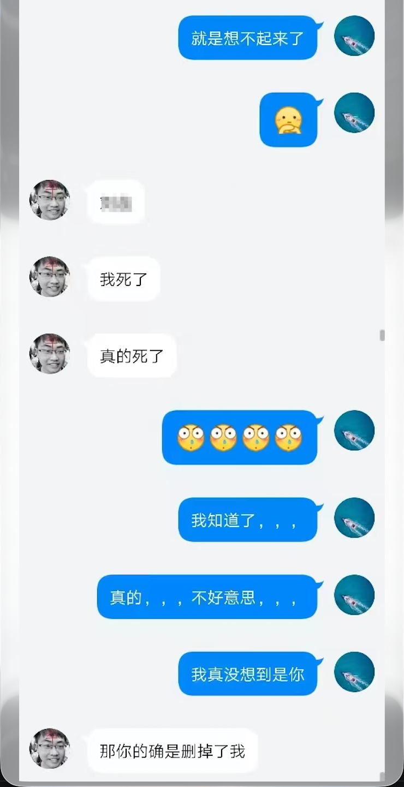
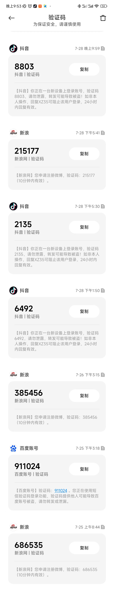
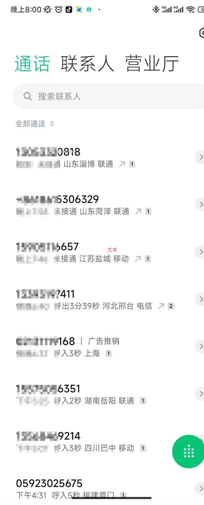
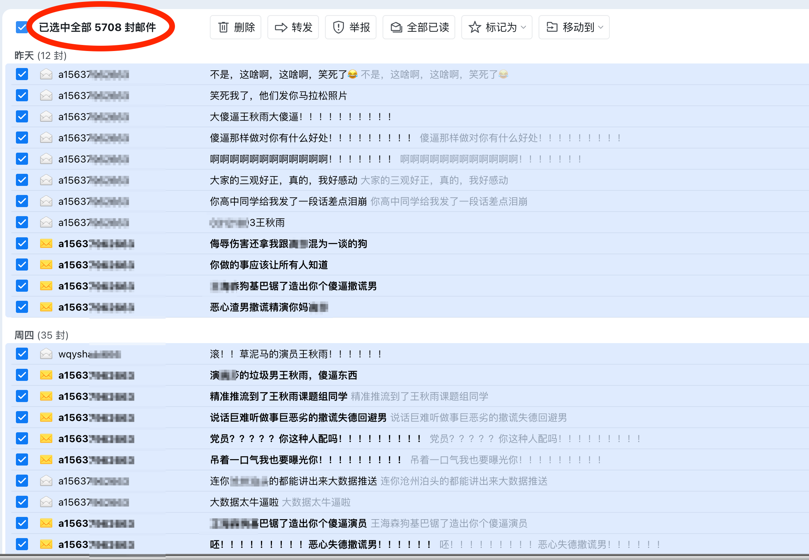
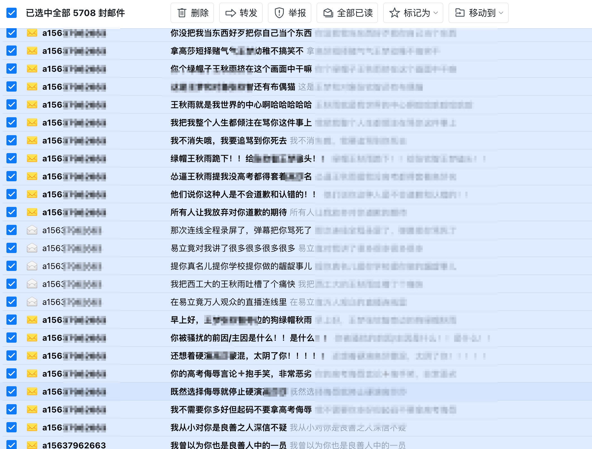

# 关于近期网络言论的情况说明

## 前言

近来很多人被某斯小红书所发的实名帖子吸引。有些还能收到其撰写的小作文——罔顾事实，博取同情，贼喊捉贼。其对我的骚扰、侮辱和谩骂已持续数十年，而今终于公开化，占用公众注意力，且严重侵犯我隐私、名誉等权利。写此文，讲清过程，是非各位看官可自行评判。

## 事情经过

### 同学关系

首先讲明关系：此人是我小学同学，而且同班时间并不长。印象中，这个人腿部残疾，不能独立行走。小学毕业（2012 年）后，就没联系，也没交集，甚至忘记了这个人的存在。

### QQ 骚扰的开始

后来某天突然有人加我 QQ，说我把她删掉了。但后续询问姓名等信息也不透露，所以在感觉莫名其妙后，我就直接删掉她的 QQ。从此她开始不断发验证消息，发各种带有侮辱性的谩骂语句。

我设置了 QQ 验证防止骚扰，此人便冒充我加入我高中同学群，其头像采用我照片，并附带侮辱性的元素，让我很多同学以为我有特殊癖好。此人当时还和我大部分高中同学彻夜长谈，大一（2018 年）时我才知道，于是跟其 battle 起来，也才第一次知道这斯的身份。

### 第一次正面冲突

在这一次 battle 有些细节：我考虑到这斯是残疾人，最开始是原谅这斯冒充我的身份的，并且其让我对删除其道歉，我甚至还道歉了。但是之后几天，谩骂侮辱的言语依然不停，回骂之后仍不收敛。于是有了其所写小作文中的内容。最后是通过亲戚关系找到它家里人，才做消停。

### 间歇性骚扰

后来又是间歇性的：这斯通过冒充瓜大同学进迎新群，发动不明事理网友给我打电话，通过头像昵称和 QQ 验证消息等骚扰谩骂，甚至波及我的朋友和同学。

### 最近一波

最近一波开始在三月份：这斯发现了可以给我发送 QQ 邮件，于是到现在已经连续发送了数千封骚扰邮件，带着我家人、朋友、同学一同修图谩骂，并且还采用追踪邮件等方式检查我是否查阅邮件。直到这一次，在公共平台上发布消息。

## 为什么现在才公开

对我来讲，此状况已经持续数十年。由于手机号并未注册微信，所以这斯主要攻击手机号和 QQ。这两种都可通过屏蔽等人为方式解决，所以我认为之前纯粹个人之间骚扰，没有必要追究。但是现在已经在公开平台上泄露个人信息，那我便把具体过程公开。

## 几个 QA

**Q1：所谓"你做的那些事"，到底做了什么？**

删除这斯，拉黑这斯，没忍住怒火骂这斯。仅此而已。且这是 2019 年发生，之后我便惹不起躲得起，没有对其做出任何回应。

**Q2：你们是不是有什么关系，为什么老找你？**

就是小学同学，同学两年。没任何关系，这个问题的任何揣测都非常恶心。

**Q3：为什么不报警？**

报警过，但是警察以调解为主。其还倒打一耙，声泪俱下，让警察也很难。并且诸如其发动网友给我打电话这些事情找不到他证据，也不能立案。

**Q4：这斯发送骚扰内容是什么？**

翻来覆去就是那么几句话：就是 18 年、19 年怎么着；我对我家里人进行侮辱；我原来同学怎么样。

**Q5：她提到的那些都是什么人？**

是我原来的同学，有过共同经历和不愉快，但是跟这斯有什么关系，且已经过了十年。来来去去还是这几个。

**Q6：那你怎么想？**

《逍遥游》有言：

> 且举世誉之而不加劝，举世非之而不加沮，定乎内外之分，辩乎荣辱之境，斯已矣。

**Q7：为什么这么豁达？**

不豁达还能怎么样，穿鞋的怕缺脚的。咱原来有学业，现在有事业，已经蜕了几层皮，哪有时间精力去斗这些乱七八糟的事情。
